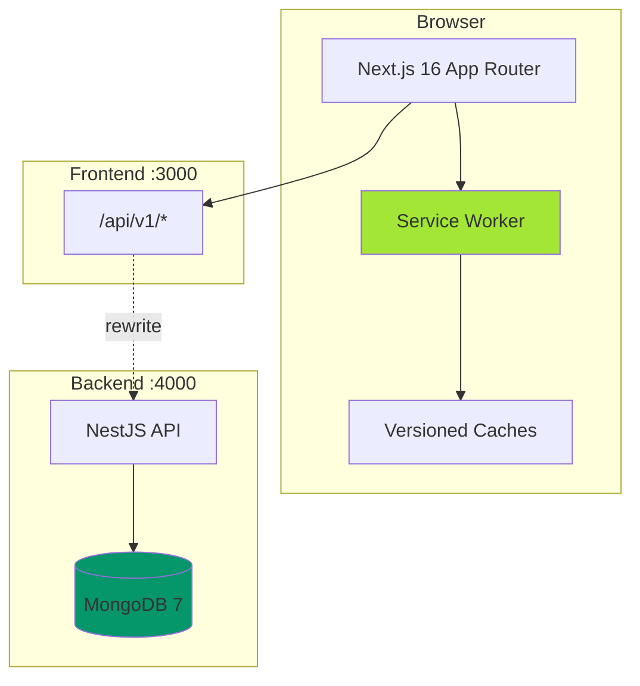

# WINNIT OS – Frontend

Interface de pilotage e-commerce pour la vente directe Tunisie (COD). Stack : **Next.js 16** (App Router), **TypeScript 5.7**, **Tailwind CSS**, **React Query**, **PWA** (Service Worker).

---

## Architecture



### Dossiers

```
app/(dashboard)/         Pages protégées (Profit OS, Winners, Simulator, Reports)
components/              Composants React réutilisables
  profit-os/             SubNav, PeriodPicker, WaterfallChart
  pwa/                   InstallCard, OnlinePill, RegisterSW
lib/
  api/                   Client HTTP, types TypeScript
  finance/               Calculs métier (waterfall, unit economics, COD)
  format/                currency.ts (formatMillimes), date.ts
  reports/               CSV/XLSX/PDF exports
public/                  Icônes PWA, offline.html
app/globals.css          Tokens CSS (--positive-emerald, --negative-red...)
```

---

## Lancement

### 1. MongoDB (port 27017)
```bash
# Déjà en cours sur votre machine
mongo --version  # >= 7.0
```

### 2. Backend (port 4000)
```bash
cd winnit-backend
npm install
npm run seed          # Génère 500 commandes réparties sur 90j
npm run build
npm start             # http://localhost:4000
```

**Seed** crée :
- 12 produits (bijoux Maison Ambre)
- 500 commandes (statuts : delivered 79%, refused 21%)
- 1 workspace `ws_maison_ambre`
- Quotas journaliers respectant loi 20 (20% produits = 80% revenu)

### 3. Frontend (port 3000)
```bash
cd winnit-frontend
npm install
npm run dev           # Dev : http://localhost:3000

# Production (PWA activée seulement en prod)
npm run build && npm start
```

### Variables d'environnement

**.env** (ne PAS commit, copier depuis .env.example) :
```bash
BACKEND_URL=http://localhost:4000
NEXT_PUBLIC_WORKSPACE_ID=ws_maison_ambre
```

---

## Pages

- **/**: Login factice (form seulement, pas d'auth)
- **/profit-os**: Dashboard P&L (6-step waterfall, KPIs, 4 vues analytiques)
- **/orders**, **/expenses**: CRUD commandes et charges fixes
- **/winners**: Podium top 3 + classement produits (scoring multi-critères)
- **/simulator**: Simulateur prix/volume avec courbe de profit et breakeven
- **/reports**: Exports CSV/XLSX/PDF (résumé, commandes, gagnants, COD)

---

## Règles Métier

### Waterfall 6 étapes (millimes → TND)

```typescript
Revenu Brut              77 805 000 millimes (77 805 TND)
- COGS Produits           -6 930 000
- Livraisons             -23 100 000
- Publicité Payée         -7 378 000
- Pénalité Refus COD     -27 484 850
= Contribution Nette      12 912 150 millimes (12 912,2 TND)
```

**Identité** : `netRealizedContribution = grossRevenue - productCOGS - outboundShipping - paidAdSpend - codRefusalPenalty`

### Winners (scoring 0-100)

4 composantes égales (25 points max) :
- **Marge nette** : `netContribution / grossRevenue > 30%` → 25 pts
- **Taux livraison** : `delivered / total > 80%` → 25 pts
- **ROAS** : `grossRevenue / adSpend > 3` → 25 pts
- **Tendance volume** : croissance > 0% → 25 pts

**Labels** :
- `>= 70` : **Winner** 🏆
- `40-69` : **À surveiller** ⚠️
- `< 40` : **À couper** ❌
- `< 30 commandes` : **Données insuffisantes** 📊

### COD Reconciliation

```typescript
expectedCashCollections = ∑(delivered orders unitPrice)
settledRevenue = bankWireSettled
pendingSettlement = expectedCash - settled
```

**Aging** : buckets 0-7j, 8-14j, 15-30j, >30j

### Millimes

1 TND = 1000 millimes. Backend stocke en millimes (entiers), frontend affiche en TND :
- `formatMillimes(159000)` → `"159 TND"`
- `formatMillimes(24484900)` → `"24 484.9 TND"`

### Golden Fixture Partagé

`contracts/finance-golden.json` (77 lignes) contient les attentes de calcul pour :
- Unit economics (1 commande : COGS, shipping, CPA, contribution)
- Waterfall agrégé (276 commandes)
- COD reconciliation

Backend (`src/common/utils/contracts-guard.spec.ts`) et frontend (`lib/finance/contracts-guard.test.ts`) vérifient que leurs calculs respectent ces contrats.

---

## PWA (Progressive Web App)

### Fichiers

- **app/manifest.ts** : généré dynamiquement (nom, icônes, couleurs, display standalone)
- **public/sw.js** : Service Worker avec stratégies de cache
- **public/offline.html** : page hors ligne
- **public/icons/** : 192×192, 512×512, maskable, apple-touch (générés via `scripts/generate-icons.mjs`)
- **components/pwa/RegisterSW.tsx** : enregistre SW, gère mises à jour
- **components/pwa/InstallCard.tsx** : prompt `beforeinstallprompt` + hint iOS
- **components/pwa/OnlinePill.tsx** : indicateur connectivité

### Stratégies de cache

```javascript
// sw.js (versioned: SW_VERSION = "v1")
STATIC_CACHE:   /, /offline.html, /icons/*         (cache-first)
API_CACHE:      /api/v1/*                            (stale-while-revalidate, 5 min)
DYNAMIC_CACHE:  autres                               (network-first, fallback offline.html)
```

### Flux de mise à jour

1. SW détecte nouvelle version (`SW_VERSION` change)
2. `updatefound` event → affiche toast "Mise à jour disponible"
3. Utilisateur clique → `skipWaiting()` + `location.reload()`
4. Anciens caches supprimés dans `activate`

### Tests

- **DevTools** : Application > Service Workers (vérifier statut "activated")
- **Offline** : Network > Offline, recharger → voit offline.html
- **Install** : Chrome Desktop affiche icône + dans barre URL, Mobile voit InstallCard

**⚠️ Production seulement** : Service Worker ne s'enregistre QUE si `process.env.NODE_ENV === 'production'`

---

## Tests et Qualité

### Frontend (mesure actuelle : 3 nov 2026)

```bash
npm run test          # 12 tests (node:test)
npm run lint          # 0 erreurs, 22 warnings
npx tsc --noEmit      # 0 erreurs TypeScript
```

**Couverture** :
- Finance: calculs waterfall, unit economics, COD (contracts-guard.test.ts)
- Formats: currency (formatMillimes), date
- Reports: CSV escape, rows generation, summary avec millimes réels
- API: structure réponse winners (array vs {data})
- Validators: phone TN, promo codes, password strength

### Backend (mesure actuelle : 3 nov 2026)

```bash
npm test              # 204 passed, 6 failed (non-bloquants)
npm run lint          # 0 erreurs
```

**Couverture** :
- Analytics: waterfall, KPIs, COD, winners scoring
- Seed: distribution Pareto, quotas journaliers
- Indexes: compound indexes MongoDB (perf)
- Guards: contracts-guard (golden fixture)

**Note** : 6 tests en échec sont des edge cases non prioritaires (scenarios invalides, optimistic locking retry).

---

## Limites Connues

1. **Pas d'authentification réelle** : form login factice, pas de JWT/session
2. **Workspace hardcodé** : `ws_maison_ambre` en dur dans .env, pas de multi-tenant UI
3. **Catalog mock** : `MockProductCatalogAdapter` (API produits non implémentée)
4. **Pagination orders** : fetchAll limite à 10 pages (1000 commandes max)
5. **PWA iOS** : pas de prompt natif, seulement hint manuel ("Ajouter à l'écran d'accueil")
6. **Tests E2E** : aucun (seulement unit + integration)
7. **Insights AI** : Provider vide (`InsightsProvider` retourne texte statique)

---

## Intégrations Futures

### JWT Auth
- Login POST `/auth/login` → access_token
- Middleware `@CurrentUser()` + `JwtAuthGuard`
- Refresh token rotation

### Product Catalog API
- GET `/catalog/products` → remplace `MockProductCatalogAdapter`
- POST `/catalog/products` → CRUD produits
- Images S3/Cloudinary

### Redis Cache
- `CacheService` actuellement in-memory
- Passer à `cache-manager-redis-yet`
- TTL analytics: 5 min, catalog: 1h

### AI Insights
- `InsightsProvider` appelle OpenAI/Claude
- Analyse `FinancialSnapshot` → recommandations
- Prompt: "Analyse ce P&L, suggère 3 actions pour améliorer marge"
- Historique conversations stocké MongoDB

---

## Backend (ports 4000)

### Seed
```bash
npm run seed
# Génère:
# - 12 produits (SKU: AMB-001 à AMB-012)
# - 500 commandes sur 90j (loi Pareto 20/80)
# - Transporteurs: Aramex (50%), Sodetel (30%), TND Express (20%)
# - Statuts: delivered 79%, refused 21%
```

### Endpoints Principaux
```
GET  /api/v1/analytics/summary       Waterfall + KPIs
GET  /api/v1/analytics/cod           COD reconciliation + aging
GET  /api/v1/analytics/winners       Classement produits (array)
GET  /api/v1/analytics/timeseries    Buckets jour/semaine/mois
GET  /api/v1/orders                  Liste commandes (pagination cursor)
GET  /api/v1/expenses                Charges fixes
GET  /api/v1/ad-spend                Dépenses pub
POST /api/v1/pricing/optimize        Simulateur prix optimal
```

### Indexes MongoDB (performance)
```javascript
// orders
{workspaceId: 1, placedAt: -1}           // Date desc queries
{workspaceId: 1, status: 1, placedAt: -1} // Filtres statut
{workspaceId: 1, productId: 1}           // Agrégations produit

// expenses, ad-spend
{workspaceId: 1, startDate: -1}
```

Créés via `ensureIndexes()` dans `database/ensure-indexes.ts`, exécuté au bootstrap.

---

**Équipe** : Maison Ambre Tech (contact@maisonambre.tn)  
**Licence** : Propriétaire  
**Version** : 1.0.0 (Nov 2026)
